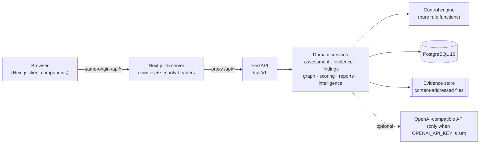
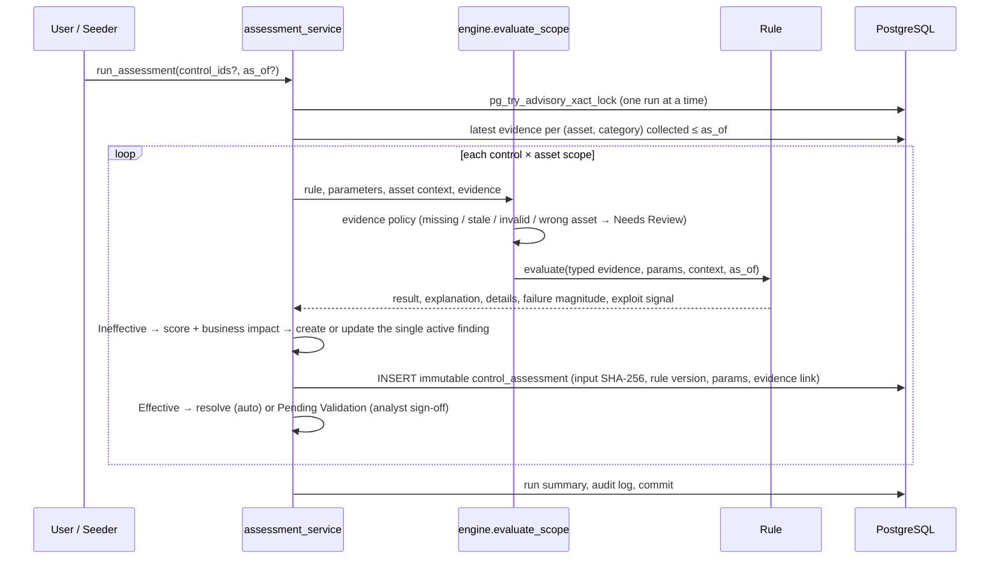

# ControlIQ — Architecture

ControlIQ is a continuous technology-controls monitoring and risk-intelligence platform, demonstrated
against **Alpha Beta Bank**, a fictional organisation. All data is synthetic.

## System overview



| Layer | Technology | Responsibility |
| --- | --- | --- |
| UI | Next.js 15 (App Router), TypeScript, Tailwind v4, shadcn/ui (Base UI), Lucide, Recharts, React Flow + dagre, TanStack Query/Table | Presentation, client-side filtering, what-if score simulation |
| Edge | Next.js rewrites | Proxies `/api/*` to the backend so the session cookie is first-party; adds `X-Frame-Options`, `nosniff`, `Referrer-Policy` |
| API | FastAPI, Pydantic v2 | Authentication, permission checks, validation, serialisation |
| Domain | Python services | Assessment orchestration, findings lifecycle, scoring, dependency graph, reports, intelligence |
| Persistence | SQLAlchemy 2, Alembic, PostgreSQL 16 | Relational model, immutability trigger, partial unique indexes |
| Files | Local filesystem (`backend/storage/evidence`) | Content-addressed evidence files named by SHA-256 |

The browser never talks to the backend directly. Every request goes to the Next.js origin, which
proxies it, so cookies are `SameSite=Lax`, first-party and `HttpOnly`.

## Backend layout

```
backend/app
├── main.py              FastAPI app, CORS, Origin check (CSRF defence), security headers, /api/health
├── api/v1/              Routers: auth, dashboard, assets, services, controls, assessments, evidence,
│                        findings (+ remediation), risks, intelligence, reports, demo, platform
├── controls/            Control engine: rule base class, 10 rules, evidence schemas, evaluation pipeline
├── risk/                Pure modules: scoring.py (5-factor score), graph.py (dependency traversal, SPOF)
├── services/            Orchestration: assessment, evidence, finding, dashboard, graph, report,
│                        intelligence, settings, demo
├── models/              SQLAlchemy models (see DATA_MODEL.md)
├── core/                Config, database, security (Argon2, session HMAC), permissions, rate limiter, audit
└── seed/                Deterministic synthetic dataset and 90-day assessment replay
```

## Control assessment pipeline



Key properties:

- **Deterministic rules.** Each rule is a pure function of typed evidence, parameters, asset context
  and the evaluation timestamp (`as_of`). The same inputs always give the same result.
- **Evidence policy before rules.** Missing, stale, schema-invalid or wrong-asset evidence produces
  **Needs Review**, never an assumed pass. A control can configure Ineffective for missing or stale
  evidence explicitly; Backup Recovery Testing does this for overdue tests.
- **Immutable, reproducible assessments.** Each assessment stores the rule key and version, the
  parameters, the asset context, the evidence link and a SHA-256 *input hash* of those inputs.
  `POST /assessments/{id}/replay` re-executes the recorded rule and checks the result, the
  explanation, the input hash and the evidence-file hash.
- **No duplicate findings.** A partial unique index (`control_id, asset_id WHERE status <> 'Resolved'`)
  allows only one active finding per control scope. Re-runs update it; they never create a duplicate.
- **Resolution only through evidence.** Findings move to Resolved only when a reassessment returns
  Effective, either automatically or after analyst sign-off depending on the validation mode.
- **Concurrency.** A process lock plus a PostgreSQL transaction-level advisory lock prevent
  overlapping runs. A concurrent request receives HTTP 409.

## Dependency graph and potential exposure

`risk/graph.py` holds a directed graph: services depend on assets, and assets depend on other assets.
It provides cycle-safe upstream and downstream traversal, the set of impacted services for an asset
(with hop distance), the shortest dependency chains, and single points of failure. A single point of
failure is a Critical or High asset with no documented redundancy, ranked by how many services share it.

A service's **potential exposure index** is `0.7 × highest unresolved finding score + 0.3 × mean of the
top three` across every unresolved finding in its dependency closure. The UI always presents it as
*potential exposure*, never as a confirmed incident.

## Intelligence layer

`intelligence_service` maps a question to a supported intent, retrieves the relevant stored records,
and builds facts, recommendations and citations deterministically.

- **No API key** → the answer is labelled **"Rule-based intelligence"** and assembled from templates.
- **API key configured** → the same retrieved records (and only those) go to the model with a
  restrictive system prompt. Every ID in the response is checked against the retrieved records, and
  unknown IDs are flagged in a visible grounding notice.
- **Model call fails** → the rule-based answer is shown with an explicit notice saying the AI service
  was unavailable. The substitution is never silent.

The assistant has no write path. It cannot create evidence, change findings or approve risk acceptance.

## Frontend layout

```
frontend/src
├── app/login                   Sign-in page with synthetic demo accounts
├── app/(app)/                  Authenticated shell (sidebar, top bar, synthetic-data banner)
│   ├── page.tsx                Executive Overview
│   ├── controls, assessments   Control Monitoring, control detail, immutable assessment record + replay
│   ├── assets, services        Inventory (CRUD) and the React Flow dependency map
│   ├── risks                   Risk register and traceability chain
│   ├── findings                Findings list, detail, workflow dialogs, remediation actions
│   ├── evidence                Evidence Center and evidence detail
│   ├── intelligence, reports   Assistant and report preview / PDF export
│   └── settings                Demo scenarios, scoring weights, validation workflow, users, audit log
├── components/                 Shared UI (data table, score breakdown, dependency map, dialogs)
└── lib/                        API client, formatting, scoring mirror, permissions, hooks, types
```

The UI hides actions the current role cannot perform. **Enforcement is in the backend.** Every endpoint
declares its required permission, so hiding a button is only a convenience.

## Deployment model (demo)

Single-instance FastAPI (uvicorn) and Next.js (`next start`) processes with one PostgreSQL database.
See [SECURITY.md](SECURITY.md) for what changes for a production deployment.
