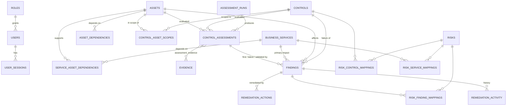
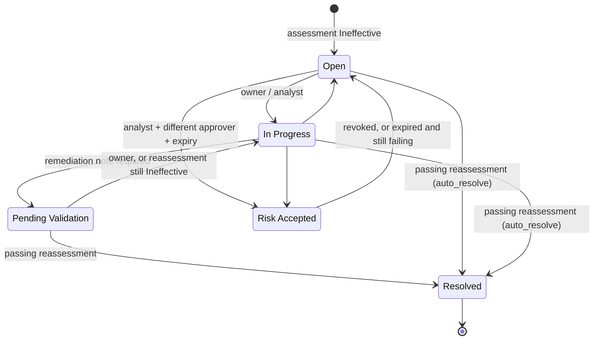

# ControlIQ — Data Model

The schema is defined in SQLAlchemy (`backend/app/models`) and created by the Alembic migration
`backend/alembic/versions/0001_initial_schema.py`. Controlled vocabularies (statuses, severities, tiers)
are stored as strings and enforced with `CHECK` constraints.

Records with integer keys expose human-readable references: `FND-0001` (finding),
`ASM-000001` (assessment), `EVD-00001` (evidence), `RUN-0001` (assessment run), `REM-0001`
(remediation action) and `RPT-0001` (report). Inventory, control and risk records use natural keys
such as `DB-TXN-001`, `CTRL-IAM-001`, `SVC-PAY` and `RSK-001`.

## Entity relationships

## Tables

### Identity

| Table | Key columns | Notes |
| --- | --- | --- |
| `roles` | `key`, `name`, `permissions` (JSON list) | Four roles: `executive_viewer`, `risk_analyst`, `control_owner`, `administrator` |
| `users` | `email` (unique), `full_name`, `role_id`, `password_hash` (Argon2), `is_active`, `can_login` | Owners who are not demo accounts have `can_login = false` and no password |
| `user_sessions` | `token_hash` (unique), `expires_at`, `ip_address`, `user_agent` | Only an HMAC-SHA256 of the session token is stored, never the token |

### Inventory

| Table | Key columns | Notes |
| --- | --- | --- |
| `business_services` | `id`, `name`, `tier` (Tier 1–3), `customer_facing`, `rto_hours`, `daily_transaction_volume` | Payments, Online Banking, Card Services, and others |
| `assets` | `id`, `asset_type`, `environment`, `criticality`, `internet_exposed`, `privileged_access_hub`, `has_redundancy`, `lifecycle_status` | Exposure and redundancy attributes feed scoring and single-point-of-failure detection |
| `asset_dependencies` | `asset_id → depends_on_asset_id`, `dependency_type` | Directed edges; self-dependency is rejected by `CHECK`, and each pair is unique |
| `service_asset_dependencies` | `service_id`, `asset_id`, `role` | Direct service-to-asset dependency; unique pair |

### Controls and assessments

| Table | Key columns | Notes |
| --- | --- | --- |
| `controls` | `id`, `domain`, `frequency`, `rule_key`, `rule_parameters` (JSON), `evidence_category`, `failure_severity`, `current_status`, `next_assessment_at` | Rule parameters are configuration, not code |
| `control_asset_scopes` | `control_id`, `asset_id`, `current_status`, `latest_assessment_id` | One row per scoped control instance; unique pair |
| `assessment_runs` | `trigger` (`manual` or `scheduled`), `triggered_by_id`, `evaluated_at`, `status`, `summary` (JSON) | Groups the assessments produced by one execution |
| `control_assessments` | `run_id`, `control_id`, `asset_id`, `assessed_at`, `result`, `rule_key`, `rule_version`, `rule_parameters`, `explanation`, `details` (context, inputs, magnitude), `input_hash`, `finding_id` | **Immutable** (see below) |
| `assessment_evidence` | `assessment_id`, `evidence_id` | Links an assessment to the exact evidence it evaluated; evidence deletion is `RESTRICT`ed |

### Evidence

| Table | Key columns | Notes |
| --- | --- | --- |
| `evidence` | `evidence_category`, `file_format`, `source`, `collected_at`, `uploaded_at`, `uploaded_by_id`, `asset_id`, `control_id`, `sha256`, `validation_status` (Valid / Invalid / Unstructured), `validation_errors`, `file_ref`, `size_bytes`, `payload` (parsed JSON/CSV) | The file itself is stored as `<sha256>.<ext>`; integrity is re-verified on download and on replay |

### Findings and remediation

| Table | Key columns | Notes |
| --- | --- | --- |
| `findings` | `control_id`, `asset_id`, `service_id`, `severity`, `risk_score` (0–100), `score_breakdown` (JSON), `business_impact`, `impacted_service_ids`, `status`, `assigned_owner_id`, `due_date`, `first/latest/validated_by_assessment_id`, `acceptance_*` | See constraints and lifecycle below |
| `remediation_actions` | `finding_id`, `title`, `owner_id`, `status` (Planned / In Progress / Completed / Cancelled), `due_date` | Completing an action never resolves the finding |
| `remediation_activity` | `finding_id`, `actor_id`, `activity_type`, `from_status`, `to_status`, `message`, `assessment_id` | Append-only timeline shown on the finding page |

### Risk register

| Table | Key columns | Notes |
| --- | --- | --- |
| `risks` | `id`, `category`, `owner_id`, `inherent_rating`, `residual_rating`, `treatment`, `treatment_plan`, `review_date`, `status` | |
| `risk_control_mappings` / `risk_finding_mappings` / `risk_service_mappings` | `risk_id` plus the mapped key | Traceability chain: risk → control → assessment → finding → asset → service |

### Platform

| Table | Key columns | Notes |
| --- | --- | --- |
| `audit_logs` | `occurred_at`, `actor_email`, `action`, `entity_type`, `entity_id`, `outcome`, `ip_address`, `details` | Logins, failed logins, permission denials, workflow changes, uploads, runs, reports, AI questions, resets |
| `app_settings` | `key`, `value` (JSON) | `risk_scoring` (weights and bands), `validation_workflow` (`auto_resolve` or `analyst_signoff`), `remediation_sla_days` |
| `generated_reports` | `report_type`, `period_days`, `generated_by_id`, `sha256` | Metadata of each exported PDF |

## Integrity guarantees enforced by the database

| Guarantee | Mechanism |
| --- | --- |
| Assessment history cannot be edited | `BEFORE UPDATE` trigger on `control_assessments` always raises |
| Assessment history cannot be deleted | `BEFORE DELETE` / `BEFORE TRUNCATE` triggers raise unless the transaction set `SET LOCAL controliq.allow_purge = 'on'`. Only the demo reset/seed path and test fixtures do this |
| ORM cannot update an assessment by mistake | SQLAlchemy `before_update` listener raises |
| At most one active finding per control scope | Partial unique index `uq_findings_active_scope (control_id, asset_id) WHERE status <> 'Resolved'` |
| Risk acceptance is complete | `CHECK`: status `Risk Accepted` requires justification, approver and expiry |
| Score within range | `CHECK risk_score BETWEEN 0 AND 100` |
| Evidence used by an assessment cannot be removed | `assessment_evidence.evidence_id` is `ON DELETE RESTRICT` |

## Finding lifecycle

- **No manual Resolved.** The API rejects `Resolved` as a requested status. A finding is resolved only
  when a newer assessment of the same control scope is Effective. With the `auto_resolve` validation
  mode the engine resolves it and records `validated_by_assessment_id`. With `analyst_signoff` the
  finding moves to Pending Validation, and a Risk Analyst or Administrator confirms it. The confirmation
  is accepted only if the latest assessment is Effective and newer than the failure.
- **Risk acceptance** requires a justification of at least 40 characters, an active approver holding
  `risk:approve` who is not the requester (segregation of duties), and a future expiry. Maximum
  duration depends on severity: Critical 90 days, High 180, Medium and Low 365.
- **Re-failure.** A Pending Validation finding that is reassessed as Ineffective returns to In Progress.
  An expired risk acceptance that is still failing reopens.
- **Due dates** follow severity SLAs (Critical 14 days, High 30, Medium 60, Low 90) from detection.

## Seed data

`scripts/seed_demo.py` builds a deterministic synthetic dataset:

- Users, roles and services for Alpha Beta Bank.
- Assets, dependencies, ten controls with their scopes, risks and mappings.
- Evidence files written through the same content-addressed store as uploads.

It then **replays 90 days of scheduled assessments through the real engine**, so trend history,
findings and scores come from rule evaluations rather than being written in by hand. All names,
hostnames and figures are fictional.
